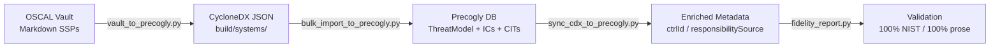
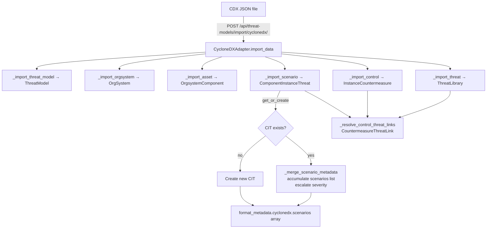
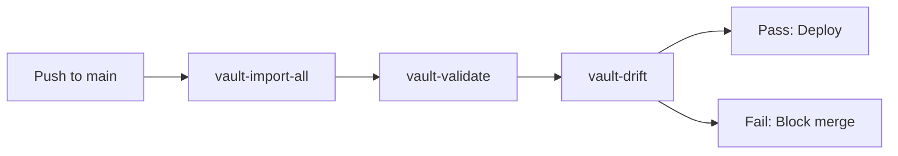
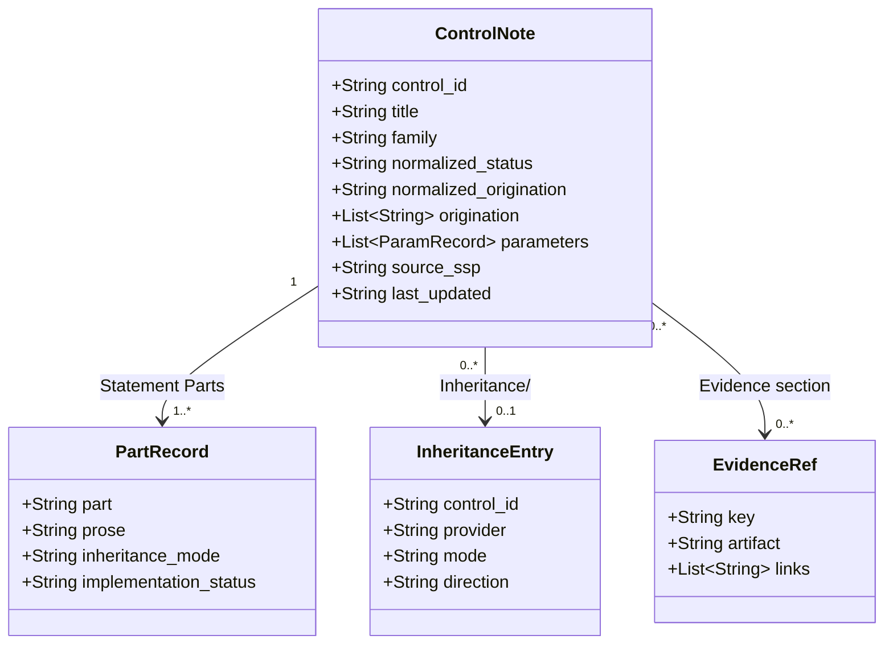
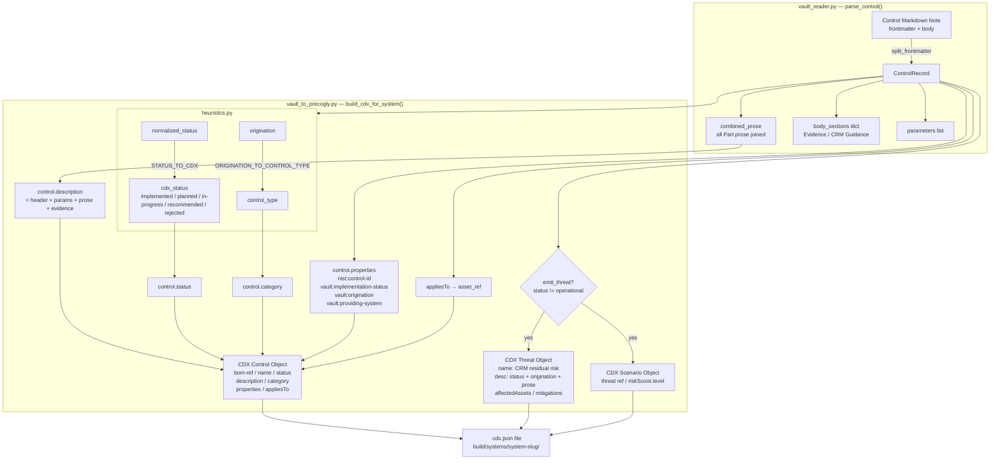
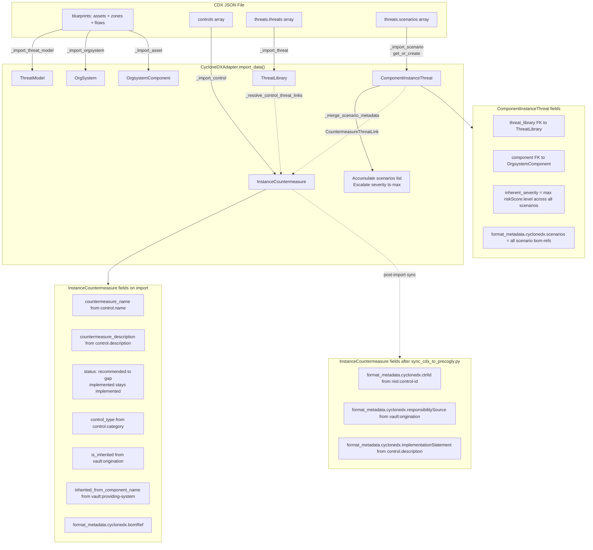
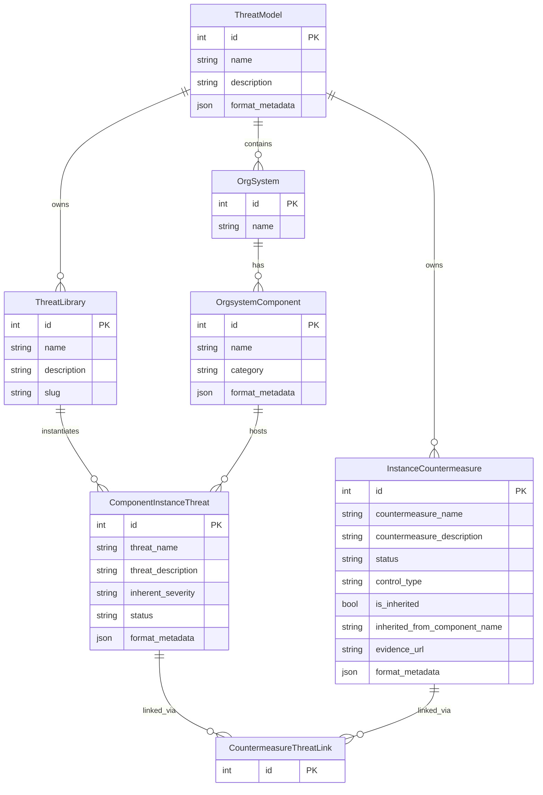
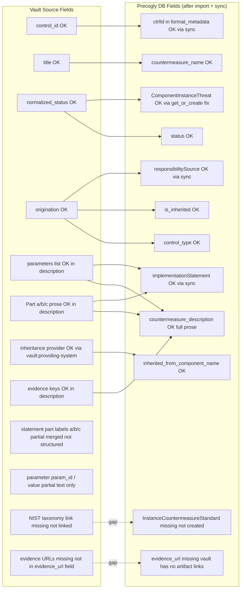
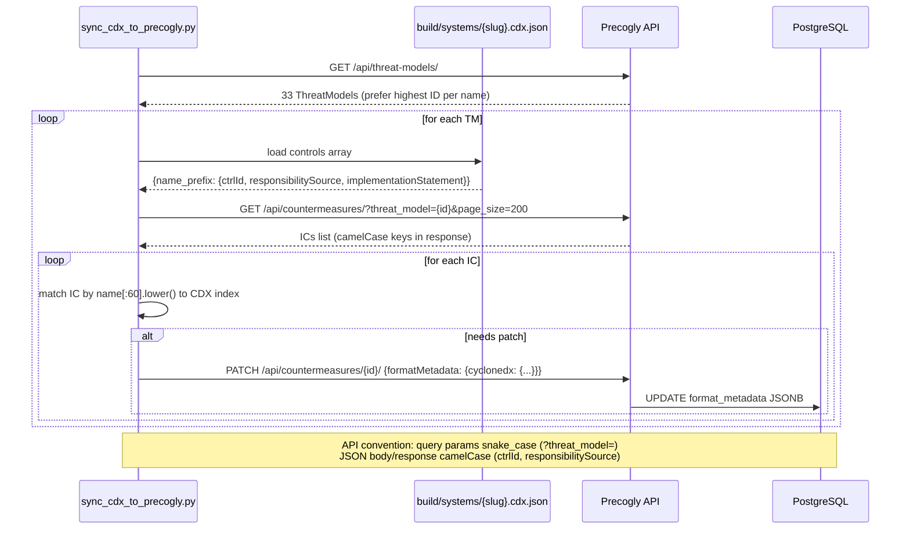
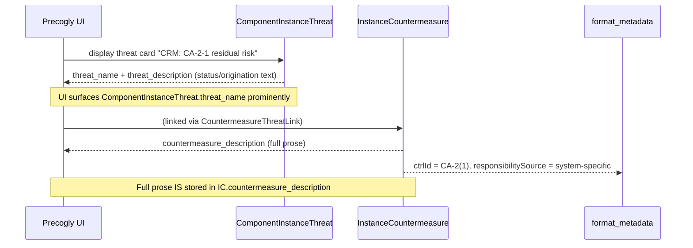

# Data Transformation Pipeline

Complete documentation of the vault → CDX → Precogly data flow, including the multi-scenario CIT fix (jjediny/precogly@32de8e7).

[← Repository README](../README.md) — the README's Sankey diagram shows how much
`.docx` material reaches the vault, and its railroad grammar shows which stages
below are optional or alternate. This file is the field-by-field reference
behind both.

Related: [Appendix A: pipeline diagrams](#appendix-a--pipeline-diagrams) (vault projection flows) ·
[Redaction guide](redaction-guide.md) (what the gate blocks) ·
the documentation index (`docs/index.md` in the parent repository)

## Pipeline Overview



## 1. Vault → CDX Projection (`vault_to_precogly.py`)

### Input: OSCAL Vault Markdown

Each control is a markdown note with:

- **Frontmatter**: `control_id`, `title`, `family`, `normalized_status`, `origination`, `parameters`
- **Body sections**: Statement parts (a/b/c), Evidence, CRM Guidance, Inheritance

### Output: CycloneDX 2.0 JSON

```json
{
  "specFormat": "CycloneDX",
  "specVersion": "2.0",
  "blueprints": [{
    "assets": [...],  // OrgsystemComponent
    "zones": [...],   // TrustZone
    "flows": [...]    // DataFlow
  }],
  "controls": [...],  // InstanceCountermeasure
  "threats": {
    "threats": [...],   // ThreatLibrary (one per control family gap)
    "scenarios": [...]  // ComponentInstanceThreat (one per control)
  }
}
```

### Transformation Logic

| Vault Field                | CDX Field                                    | Transform                                                                                                                                                          |
| -------------------------- | -------------------------------------------- | ------------------------------------------------------------------------------------------------------------------------------------------------------------------ |
| `control_id`               | `control.properties[nist:control-id]`        | Direct                                                                                                                                                             |
| `normalized_status`        | `control.status`                             | `STATUS_TO_CDX` mapping:<br>`implemented` → `implemented`<br>`partially-implemented` → `in-progress`<br>`planned` → `planned`<br>`not-implemented` → `recommended` |
| `origination`              | `control.properties[vault:origination]`      | Direct (`system-specific` \| `shared` \| `platform-inherited`)                                                                                                     |
| `origination`              | `control.category`                           | `ORIGINATION_TO_CONTROL_TYPE`:<br>`system-specific` → `procedural`<br>`shared` → `procedural`<br>`platform-inherited` → `technical`                                |
| Combined prose (all parts) | `control.description`                        | Header + params + prose + evidence                                                                                                                                 |
| Inheritance provider       | `control.properties[vault:providing-system]` | From `Inheritance/` section                                                                                                                                        |
| Inheritance mode           | `control.properties[vault:inheritance-mode]` | `fully-inherited` \| `hybrid` \| (empty)                                                                                                                           |

### Threat/Scenario Emission

For each control with `normalized_status != operational`:

1. **Threat** (one per control family):
   - `bom-ref`: `threat-{family}-{seq}`
   - `name`: `CRM: {family} residual risk - {System}`
   - `description`: Status + origination + prose summary
   - `affectedAssets`: `[asset-{system-slug}]`

2. **Scenario** (one per control):
   - `bom-ref`: `scenario-{control-id}-{seq}`
   - `threat`: `threat-{family}-{seq}`
   - `affectedAssets`: `[asset-{system-slug}]`
   - `riskScore.level`: `STATUS_TO_RISK_LEVEL` mapping

### Example: CA-2(1)

**Vault input:**

```yaml
control_id: CA-02(01)
normalized_status: not-implemented
origination: [system-specific]
Part a prose: 'GSA OCISO: None, if the assessment is performed by GSA OCISO contracted assessors...'
```

**CDX output:**

```json
{
  "controls": [{
    "bom-ref": "control-ca-2-1-28",
    "name": "CA-2(1) implementation - Gsa Pages Ssp 2026",
    "status": "recommended",
    "category": "procedural",
    "description": "Fulfills CRM responsibility for CA-2(1)...\n\nPart a:\nGSA OCISO: None...",
    "properties": [
      { "name": "nist:control-id", "value": "CA-2(1)" },
      { "name": "vault:implementation-status", "value": "not-implemented" },
      { "name": "vault:origination", "value": "system-specific" }
    ]
  }],
  "threats": {
    "threats": [{
      "bom-ref": "threat-ca-2-1-28",
      "name": "CRM: CA-2-1 residual risk - Gsa Pages Ssp 2026",
      "affectedAssets": ["asset-gsa-pages-ssp-2026"],
      "mitigations": ["control-ca-2-1-28"]
    }],
    "scenarios": [{
      "bom-ref": "scenario-ca-2-1-28-a",
      "threat": "threat-ca-2-1-28",
      "affectedAssets": ["asset-gsa-pages-ssp-2026"],
      "riskScore": { "level": "high" }
    }]
  }
}
```

---

## 2. CDX → Precogly Import (`bulk_import_to_precogly.py` + adapter)

### Import Flow



### Multi-Scenario Collapse (jjediny/precogly@32de8e7)

**Problem:** `ComponentInstanceThreat` has `unique_together = ["component", "threat_library"]`. Multiple CDX scenarios referencing the same (threat, asset) pair caused `IntegrityError`.

**Fix:** `_import_scenario()` now uses `get_or_create()` and calls `_merge_scenario_metadata()`:

```python
def _merge_scenario_metadata(instance, bom_ref, scenario_meta, severity, created):
    cdx_meta = instance.format_metadata.get("cyclonedx", {}) if not created else {}
    scenarios_seen = cdx_meta.get("scenarios", [])
    entry = {"scenario_bom_ref": bom_ref}
    if scenario_meta:
        entry["scenario"] = scenario_meta
    scenarios_seen.append(entry)
    cdx_meta["scenarios"] = scenarios_seen
    instance.format_metadata["cyclonedx"] = cdx_meta

    # Escalate severity to highest across all scenarios
    severity_rank = {"low": 0, "medium": 1, "high": 2, "critical": 3}
    if not created and severity_rank.get(severity, 0) > severity_rank.get(
        instance.inherent_severity, 0
    ):
        instance.inherent_severity = severity
    instance.save(update_fields=["format_metadata", "inherent_severity"])
```

**Result:** SR-12 with 74 scenarios → 1 CIT with `inherent_severity=high` and `format_metadata.cyclonedx.scenarios` containing all 74 bom-refs.

### Database Schema Mapping

| CDX Field                                    | Precogly Model            | Field                           | Notes                                   |
| -------------------------------------------- | ------------------------- | ------------------------------- | --------------------------------------- |
| `control.name`                               | `InstanceCountermeasure`  | `countermeasure_name`           |                                         |
| `control.description`                        | `InstanceCountermeasure`  | `countermeasure_description`    | Full prose                              |
| `control.status`                             | `InstanceCountermeasure`  | `status`                        | `recommended` → `gap`                   |
| `control.category`                           | `InstanceCountermeasure`  | `control_type`                  |                                         |
| `control.properties[vault:origination]`      | `InstanceCountermeasure`  | `is_inherited`                  | `shared` \| `platform-inherited` → True |
| `control.properties[vault:providing-system]` | `InstanceCountermeasure`  | `inherited_from_component_name` |                                         |
| `threat.name`                                | `ThreatLibrary`           | `name`                          |                                         |
| `threat.description`                         | `ThreatLibrary`           | `description`                   |                                         |
| `scenario.threat`                            | `ComponentInstanceThreat` | `threat_library`                | FK to ThreatLibrary                     |
| `scenario.affectedAssets[0]`                 | `ComponentInstanceThreat` | `component`                     | FK to OrgsystemComponent                |
| `scenario.riskScore.level`                   | `ComponentInstanceThreat` | `inherent_severity`             | Escalated to max                        |

---

## 3. Post-Import Sync (`sync_cdx_to_precogly.py`)

### Purpose

The CDX adapter doesn't populate `format_metadata.cyclonedx.ctrlId` / `responsibilitySource` / `implementationStatement` on import. This script patches them post-import for fidelity reporting.

### Algorithm

```python
# 1. Load all ThreatModels from Precogly API
tms = GET /api/threat-models/

# 2. For each TM, load CDX file from build/systems/{slug}/{slug}.cdx.json
cdx = json.load(f"build/systems/{slug}/{slug}.cdx.json")

# 3. Build index: control_name_prefix → {nist_id, responsibility_source, implementation_statement}
cdx_index = {}
for control in cdx["controls"]:
    name_prefix = control["name"][:60].lower()
    props = {p["name"]: p["value"] for p in control.get("properties", [])}
    cdx_index[name_prefix] = {
        "nist_id": props.get("nist:control-id") or props.get("crm:control-id"),
        "responsibility_source": props.get("vault:origination") or props.get("crm:responsibility-source"),
        "implementation_statement": control.get("description")
    }

# 4. Load all ICs for this TM from Precogly
ics = GET /api/countermeasures/?threat_model={tm_id}&page_size=200

# 5. For each IC, match by name prefix and PATCH if metadata differs
for ic in ics:
    name_prefix = ic["countermeasureNameDisplay"][:60].lower()
    entry = cdx_index.get(name_prefix)
    if not entry:
        continue  # no_match
    
    current_nist = ic["formatMetadata"]["cyclonedx"].get("ctrlId", "")
    needs_patch = (
        entry["nist_id"] != current_nist or
        entry["responsibility_source"] != ic["formatMetadata"]["cyclonedx"].get("responsibilitySource", "") or
        entry["implementation_statement"] != ic["formatMetadata"]["cyclonedx"].get("implementationStatement", "")
    )
    
    if needs_patch:
        PATCH /api/countermeasures/{ic_id}/ {
            "formatMetadata": {
                "cyclonedx": {
                    "ctrlId": entry["nist_id"],
                    "responsibilitySource": entry["responsibility_source"],
                    "implementationStatement": entry["implementation_statement"]
                }
            }
        }
```

### API Conventions (Critical)

- **Query params**: snake_case (`?threat_model=275`)
- **JSON body/response keys**: camelCase (`ctrlId`, `responsibilitySource`, `formatMetadata`)
- **PostgreSQL JSONB storage**: snake_case (`ctrl_id`, `responsibility_source`)

**Pitfall:** `?threatModel=` (camelCase) silently returns ALL countermeasures unfiltered instead of erroring.

### Result

After sync:

- **100% NIST coverage** (`ctrlId` populated on all ICs)
- **100% prose coverage** (`implementationStatement` populated)
- **Inheritance metadata** (`responsibilitySource` = `system-specific` | `shared` | `platform-inherited`)

---

## 4. Validation & Reporting

### `validate_vault.py`

Structural + redaction gate for all vault-projected CDX files:

- ✅ All threats have `ctrl:id` OR `resp:ctrl-ref` property
- ✅ All controls have `ctrl:id` (if vault-style) OR `resp:evidence-key` (if CRM-style)
- ✅ All `affectedAssets` references resolve to real assets or flows
- ✅ All `mitigations` references resolve to real controls
- ✅ Bidirectional links: `threat.mitigations` ↔ `control.mitigations`
- ✅ No secrets/PII/internal hostnames in CDX (redaction gate)

**Current status:** 0 warnings across the projected portfolio (the system count is in [OPEN_WORK.md](OPEN_WORK.md) and `catalog/index.yaml`; it was 13 warnings before the ctrl:id fixes)

### `fidelity_report.py`

Queries live Precogly API to measure data quality:

```bash
PRECOGLY_TOKEN=$TOKEN uv run python scripts/catalog/fidelity_report.py --system gsa-pages-ssp-2026
```

**Output:**

```
System                  TM  Ctrl  NIST  Prose   Inh  EvidURL  Scen DFDs Flows
gsa-pages-ssp-2026     282   144  100%   100%   66%       0%    15    1   731
```

| Metric      | Description                                          | Target                           |
| ----------- | ---------------------------------------------------- | -------------------------------- |
| **NIST**    | % ICs with `ctrlId` populated                        | 100%                             |
| **Prose**   | % ICs with `implementationStatement` populated       | 100%                             |
| **Inh**     | % ICs with `responsibilitySource` = inherited/shared | Varies by system                 |
| **EvidURL** | % ICs with `evidenceUrl` populated                   | 0% (vault has no artifact links) |
| **Scen**    | Count of CITs (ComponentInstanceThreats)             | Expected: 15-101 per system      |

### `threat_countermeasure_report.py`

Joins every threat to its mitigating controls across `build/systems/*/*.cdx.json`
and the standalone Example System CRM artifact, and writes a flat CSV and a Markdown table
(`make threat-report`).

```bash
uv run python scripts/catalog/threat_countermeasure_report.py --format md --slug gsa-pages-ssp-2026
uv run python scripts/catalog/threat_countermeasure_report.py --full                    # no 300-character cut
uv run python scripts/catalog/threat_countermeasure_report.py --per-system build/reports/  # one full-text document per system
```

**CSV columns** (the first ten keep their original order; later ones are appended):

- `system`, `ctrl_id`, `threat_name`, `implementation_status`, `origination`,
  `control_name`, `control_status`, `evidence_url`, `control_description`, `stub`
- `control_type` (`vault:control-type`), `providing_system` and `inheritance_mode`
  (`vault:*`, on the control or the threat), `implementation_statement`
  (`resp:statement`), `responsibility_writeup` (`resp:writeup`)

Text columns are cut at 300 characters unless `--full` or `--per-system` is used.
Template placeholders such as `[Add Implementation ...]` are removed. Several of
the appended columns are sparse because few CDX files carry the source property
(for example, only a minority of controls carry a providing system or a statement).

---

## 5. Known Gaps & Workarounds

### Gap: Duplicate TMs on re-import

**Issue:** `bulk_import_to_precogly.py` always creates new TMs; no update-by-name logic.

**Workaround:** Manual cleanup via `DELETE /api/threat-models/{id}/` + update `sidecar.yaml`

**Tracking:** #135

### Gap: Inheritance metadata not surfaced in UI

**Issue:** `responsibilitySource` / `providing_system` stored in `format_metadata` but not displayed.

**Workaround:** Use `fidelity_report.py` or `threat_countermeasure_report.py` for inheritance analysis.

**Tracking:** #136

### Gap: NIST control rollup not surfaced

**Issue:** `crm:control-rollup` metadata (per-NIST-ID status breakdown) not displayed in UI.

**Workaround:** `make control-report` generates SSP-style control summary from live Precogly.

**Tracking:** #137

### Gap: DFD flows imported but not rendered

**Issue:** CDX `blueprints[0].flows[]` imported as DataFlow records but not rendered as visual canvas edges.

**Tracking:** #138

---

## 6. Make Targets

| Target                                              | Description                                                        |
| --------------------------------------------------- | ------------------------------------------------------------------ |
| `make vault-import VAULT_SYSTEM=gsa-pages-ssp-2026` | Project one vault system to CDX                                    |
| `make vault-import-all`                             | Project every vault system to CDX                                  |
| `make vault-validate`                               | Validate all CDX files (structural + redaction)                    |
| `make vault-precogly-all`                           | Import all CDX files into Precogly                                 |
| `make precogly-sync`                                | Sync `ctrlId` / `responsibilitySource` / `implementationStatement` |
| `make fidelity-report`                              | Generate data quality report from live Precogly                    |
| `make threat-report`                                | Generate full control statement report (CSV + MD)                  |
| `make control-report`                               | Generate NIST control rollup from live Precogly                    |

---

## 7. CI/CD Pipeline



**Drift gate:** Ensures vault-projected CDX files stay in sync with OSCAL vault source.

---

## Appendix A — Pipeline diagrams

Vault-projection flow diagrams (formerly `pipeline-diagrams.md`, merged here so each topic has one source).

### A.1 Source Data Model (Vault Obsidian Note)



**CA-2(1) example values:**

- `control_id`: `CA-02(01)`
- `normalized_status`: `not-implemented`
- `normalized_origination`: `system-specific`
- `PartRecord.part a prose`: _"GSA OCISO: None, if the assessment is performed by GSA OCISO contracted assessors…"_

---

### A.2 CDX Generation Pipeline (vault_to_precogly.py)



**CA-2(1) trace:**

- `cdx_status` = `recommended` → because `normalized_status=not-implemented`
- `emit_threat = True` → because status ≠ operational
- threat name = `"CRM: CA-2-1 residual risk - Gsa Pages Ssp 2026"`
- control description = _"Fulfills CRM responsibility for CA-2(1)… GSA OCISO: None…"_

---

### A.3 CycloneDX Import → Precogly DB (cyclonedx.py adapter)

> **Fix applied (jjediny/precogly@32de8e7):** `_import_scenario()` now uses `get_or_create()` instead of `create()`. Multiple CDX scenarios referencing the same (threat, asset) pair collapse to one `ComponentInstanceThreat` row; all scenario bom-refs are accumulated in `format_metadata.cyclonedx.scenarios[]` and severity is escalated to the highest value across scenarios. Fixes vault-style CDX imports where a single NIST control has multiple attack scenarios (e.g. SR-12 with 74 scenarios).



**CA-2(1) result in DB (after import + sync):**

| Field                                               | Value                                             |
| --------------------------------------------------- | ------------------------------------------------- |
| `countermeasure_name`                               | `CA-2(1) implementation - Gsa Pages Ssp 2026`     |
| `status`                                            | `gap` (recommended → gap)                         |
| `countermeasure_description`                        | Full prose including statement parts + parameters |
| `is_inherited`                                      | False                                             |
| `format_metadata.cyclonedx.ctrlId`                  | `CA-2(1)`                                         |
| `format_metadata.cyclonedx.responsibilitySource`    | `system-specific`                                 |
| `format_metadata.cyclonedx.implementationStatement` | Full prose                                        |

**SR-12 result (74 scenarios → 1 CIT):**

| Field                                 | Value                                           |
| ------------------------------------- | ----------------------------------------------- |
| `inherent_severity`                   | `high` (escalated from max across 74 scenarios) |
| `format_metadata.cyclonedx.scenarios` | Array of 74 `{scenario_bom_ref: ...}` entries   |

---

### A.4 Precogly Data Model (stored concepts)



**Key constraint:** `ComponentInstanceThreat` has `unique_together = ["component", "threat_library"]`. One CIT per (component, threat) pair — multiple scenarios for the same pair collapse via `_merge_scenario_metadata()`.

---

### A.5 Content Coverage Gap Analysis



**Legend:** OK = mapped and populated · partial = partially mapped (text only) · missing = not populated (tracked issues #136–#138)

---

### A.6 Post-Import Sync Pipeline (sync_cdx_to_precogly.py)



**Result after sync:**

- 100% NIST coverage (`ctrlId` on all ICs)
- 100% prose coverage (`implementationStatement` on all ICs)
- Inheritance metadata (`responsibilitySource`) on all ICs

---

### A.7 Why "CA-2-1 residual risk" shows only a control ID



The prose is present in the DB. The gap is that the Precogly **threat card view** shows `ComponentInstanceThreat.threat_name` (which contains the threat library name) rather than surfacing the linked `InstanceCountermeasure.countermeasure_description` inline. See [docs/DATA_PIPELINE.md](DATA_PIPELINE.md) for the full field mapping.

## References

- [docs/threat-model-authoring-guide.md](threat-model-authoring-guide.md) — User workflow
- `docs/dev-guide.md` — Example System YAML pipeline deep dive (parent repository)
- [docs/redaction-guide.md](redaction-guide.md) — Secrets/PII scrubbing
- `AGENTS.md` — AI agent usage policy (parent repository)
- [jjediny/precogly@32de8e7](https://github.com/jjediny/precogly/commit/32de8e7) — Multi-scenario CIT fix
