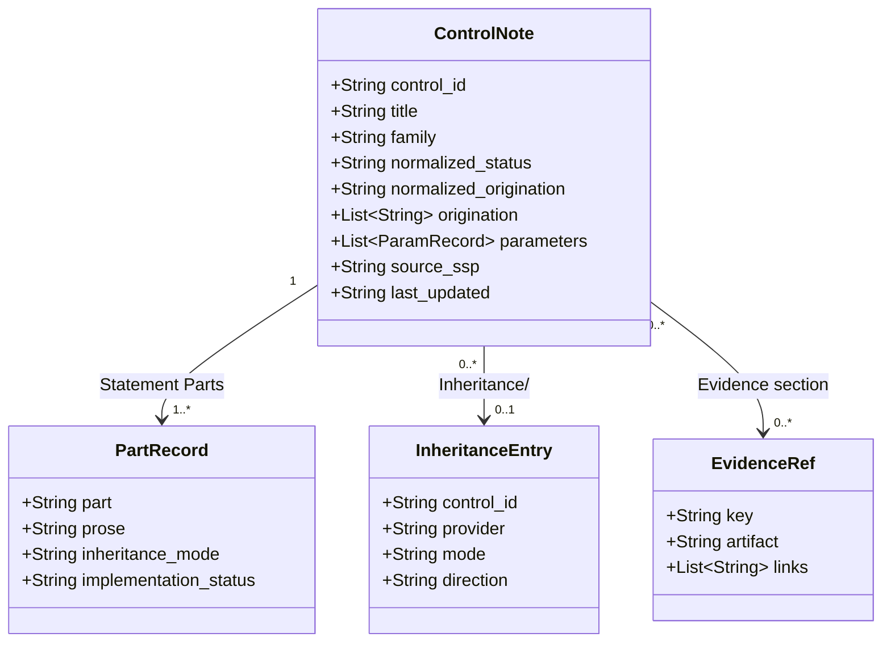
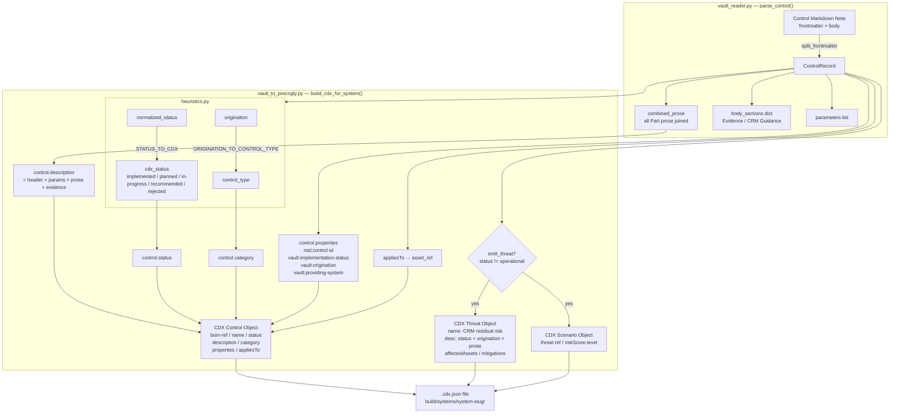
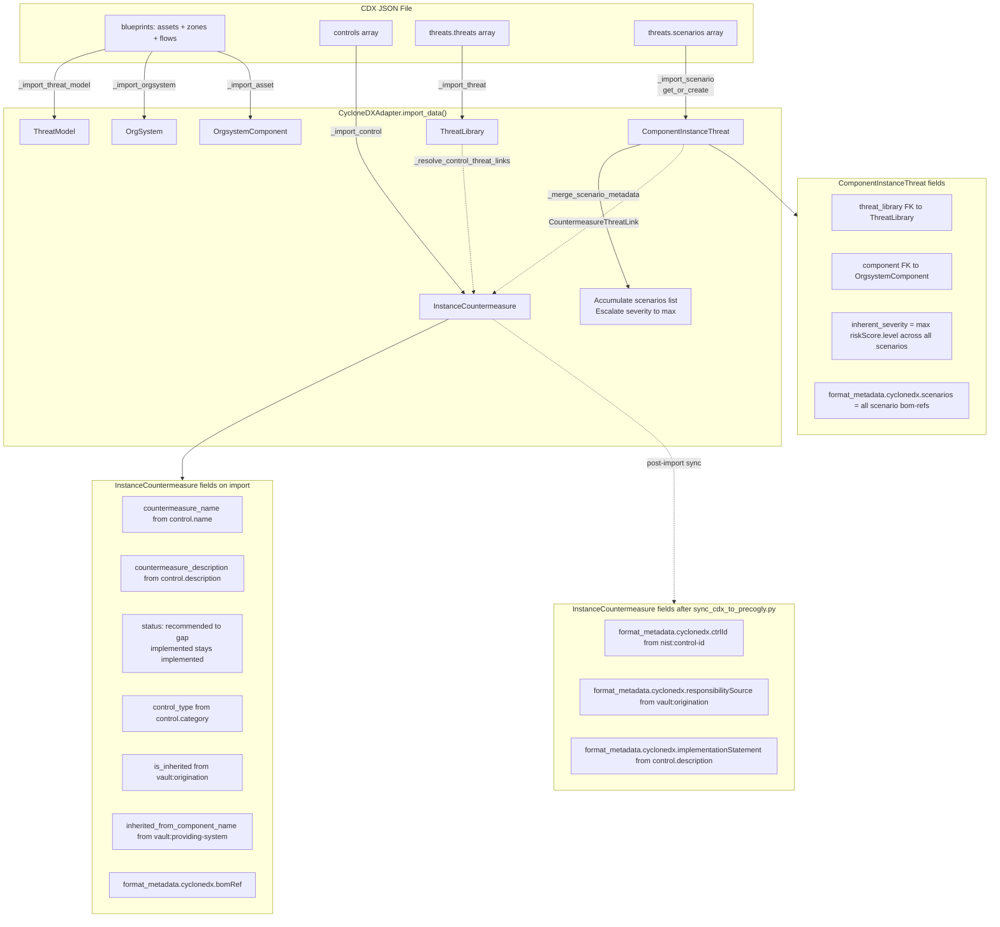
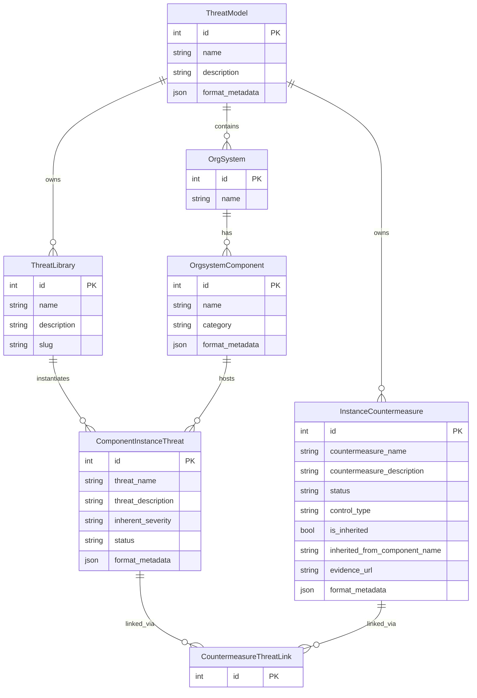
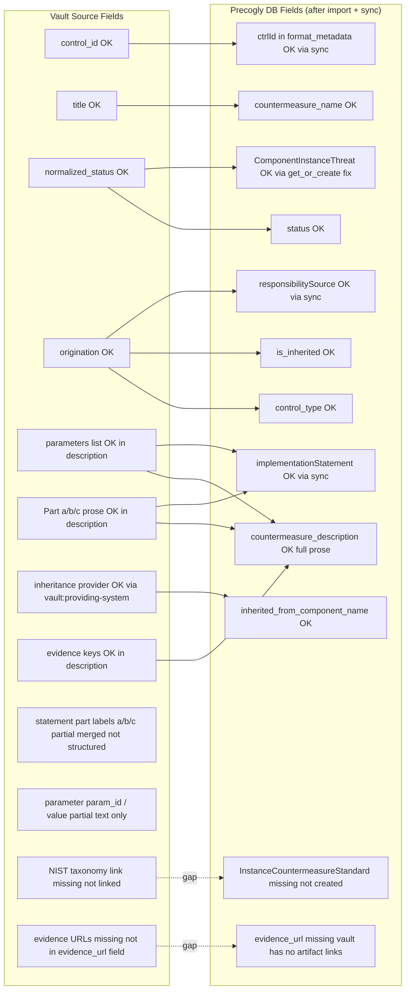
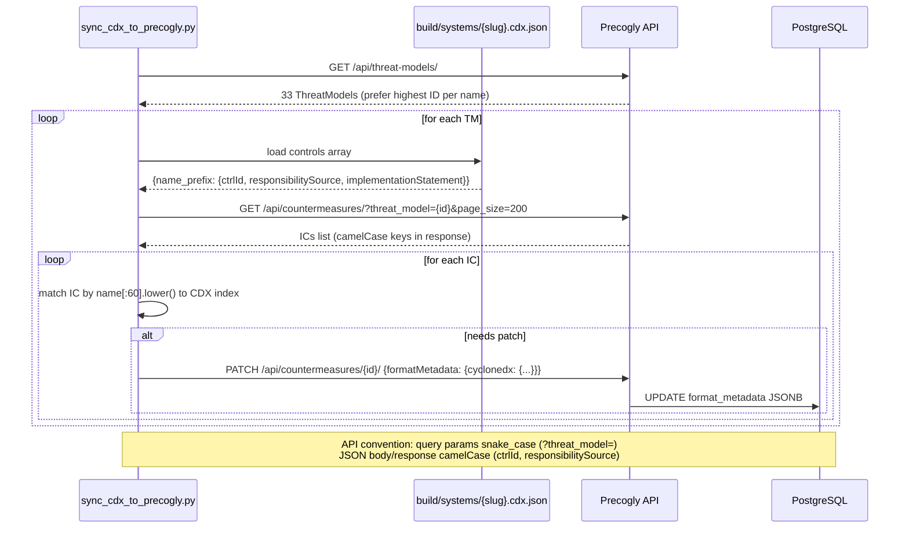
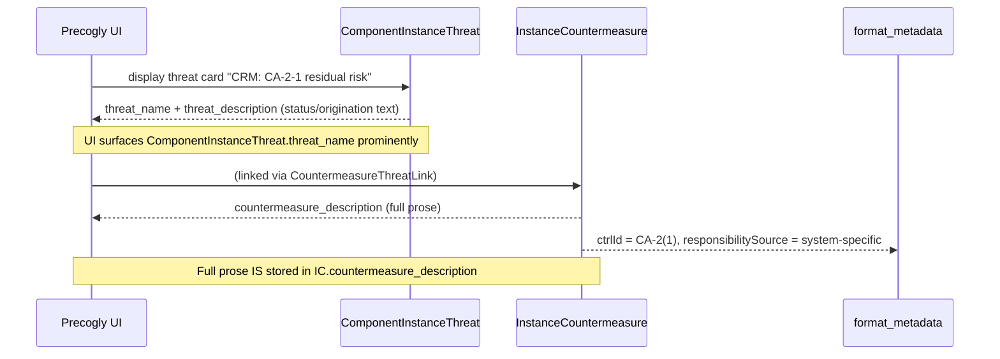

# Vault → Precogly Pipeline Diagrams

## 1. Source Data Model (Vault Obsidian Note)

**CA-2(1) example values:**

- `control_id`: `CA-02(01)`
- `normalized_status`: `not-implemented`
- `normalized_origination`: `system-specific`
- `PartRecord.part a prose`: _"GSA OCISO: None, if the assessment is performed by GSA OCISO contracted assessors…"_

---

## 2. CDX Generation Pipeline (vault_to_precogly.py)

**CA-2(1) trace:**

- `cdx_status` = `recommended` → because `normalized_status=not-implemented`
- `emit_threat = True` → because status ≠ operational
- threat name = `"CRM: CA-2-1 residual risk - Gsa Pages Ssp 2026"`
- control description = _"Fulfills CRM responsibility for CA-2(1)… GSA OCISO: None…"_

---

## 3. CycloneDX Import → Precogly DB (cyclonedx.py adapter)

> **Fix applied (jjediny/precogly@32de8e7):** `_import_scenario()` now uses `get_or_create()` instead of `create()`. Multiple CDX scenarios referencing the same (threat, asset) pair collapse to one `ComponentInstanceThreat` row; all scenario bom-refs are accumulated in `format_metadata.cyclonedx.scenarios[]` and severity is escalated to the highest value across scenarios. Fixes vault-style CDX imports where a single NIST control has multiple attack scenarios (e.g. SR-12 with 74 scenarios).

**CA-2(1) result in DB (after import + sync):**

| Field                                               | Value                                             |
| --------------------------------------------------- | ------------------------------------------------- |
| `countermeasure_name`                               | `CA-2(1) implementation - Gsa Pages Ssp 2026`     |
| `status`                                            | `gap` (recommended → gap)                         |
| `countermeasure_description`                        | Full prose including statement parts + parameters |
| `is_inherited`                                      | False                                             |
| `format_metadata.cyclonedx.ctrlId`                  | `CA-2(1)`                                         |
| `format_metadata.cyclonedx.responsibilitySource`    | `system-specific`                                 |
| `format_metadata.cyclonedx.implementationStatement` | Full prose                                        |

**SR-12 result (74 scenarios → 1 CIT):**

| Field                                 | Value                                           |
| ------------------------------------- | ----------------------------------------------- |
| `inherent_severity`                   | `high` (escalated from max across 74 scenarios) |
| `format_metadata.cyclonedx.scenarios` | Array of 74 `{scenario_bom_ref: ...}` entries   |

---

## 4. Precogly Data Model (stored concepts)

**Key constraint:** `ComponentInstanceThreat` has `unique_together = ["component", "threat_library"]`. One CIT per (component, threat) pair — multiple scenarios for the same pair collapse via `_merge_scenario_metadata()`.

---

## 5. Content Coverage Gap Analysis

**Legend:** OK = mapped and populated · partial = partially mapped (text only) · missing = not populated (tracked issues #136–#138)

---

## 6. Post-Import Sync Pipeline (sync_cdx_to_precogly.py)

**Result after sync:**

- 100% NIST coverage (`ctrlId` on all ICs)
- 100% prose coverage (`implementationStatement` on all ICs)
- Inheritance metadata (`responsibilitySource`) on all ICs

---

## 7. Why "CA-2-1 residual risk" shows only a control ID

The prose is present in the DB. The gap is that the Precogly **threat card view** shows `ComponentInstanceThreat.threat_name` (which contains the threat library name) rather than surfacing the linked `InstanceCountermeasure.countermeasure_description` inline. See [docs/DATA_PIPELINE.md](DATA_PIPELINE.md) for the full field mapping.
