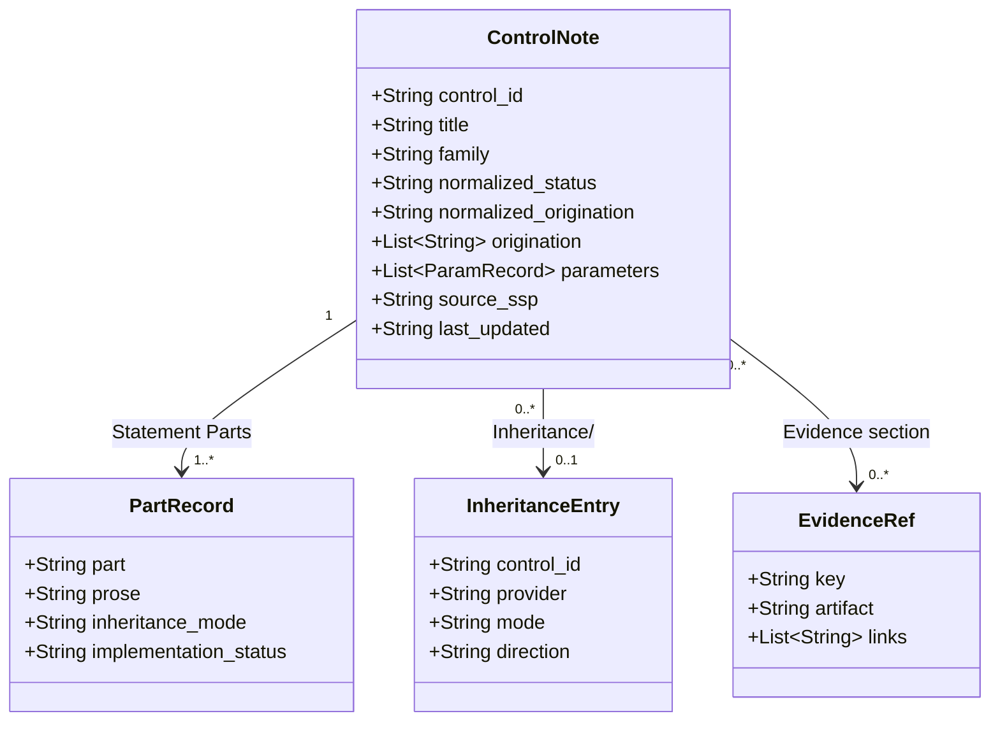
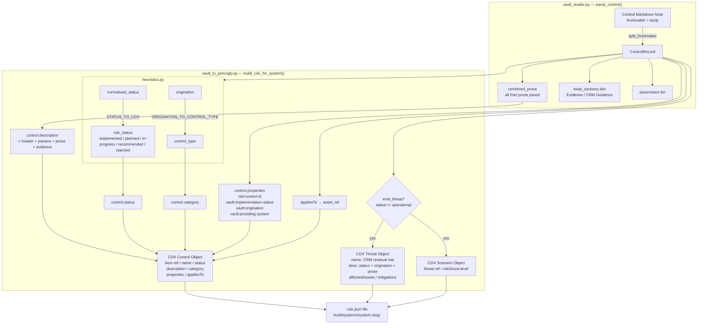
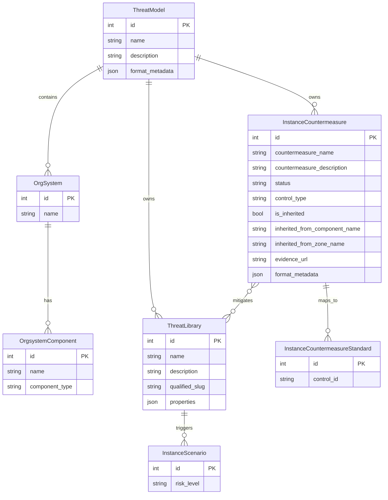
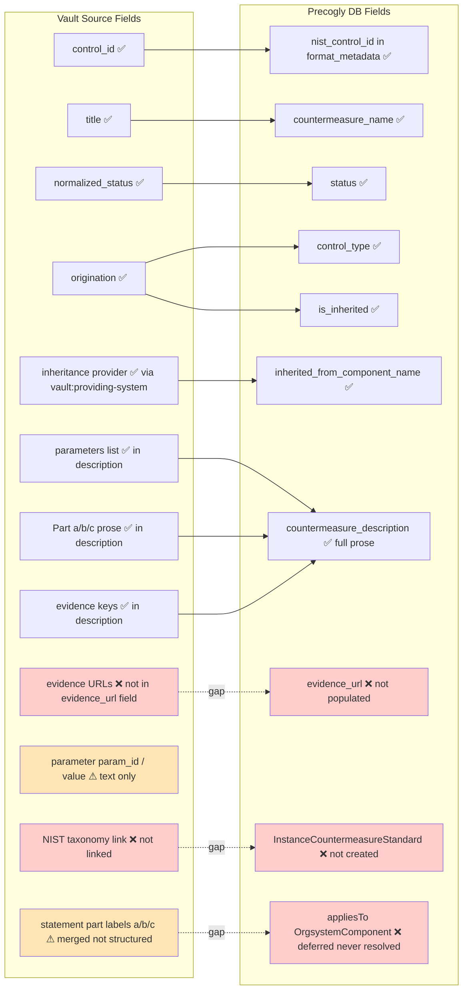
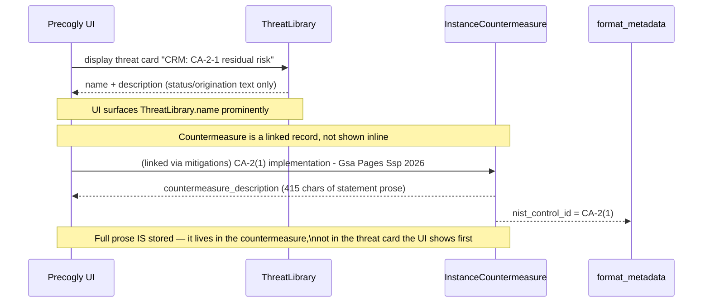

# Vault → Precogly Pipeline Diagrams

## 1. Source Data Model (Vault Obsidian Note)



**CA-2(1) example values:**
- `control_id`: `CA-02(01)`
- `normalized_status`: `not-implemented`
- `normalized_origination`: `system-specific`
- `PartRecord.part a prose`: *"GSA OCISO: None, if the assessment is performed by GSA OCISO contracted assessors…"*

---

## 2. CDX Generation Pipeline (vault_to_precogly.py)



**CA-2(1) trace:**
- `cdx_status` = `recommended` → because `normalized_status=not-implemented`
- `emit_threat = True` → because status ≠ operational
- threat name = `"CRM: CA-2-1 residual risk - Gsa Pages Ssp 2026"`
- control description = *"Fulfills CRM responsibility for CA-2(1)… GSA OCISO: None…"*

---

## 3. CycloneDX Import → Precogly DB (cyclonedx.py adapter)

```mermaid
flowchart TD
    subgraph cdx_file["CDX JSON File"]
        A1[blueprints → ThreatModel + OrgSystem]
        A2[controls array]
        A3[threats.threats array]
        A4[threats.scenarios array]
    end

    subgraph adapter["CycloneDXAdapter.import_data()"]
        A1 -->|_import_threat_model| B1[ThreatModel\nname / description]
        A1 -->|_import_orgsystem| B2[OrgSystem\ncomponent boundary]
        A1 -->|_import_asset| B3[OrgsystemComponent\nasset-{slug}]

        A2 -->|_import_control| B4[InstanceCountermeasure]
        A3 -->|_import_threat| B5[ThreatLibrary\nqualified_slug unique]
        A4 -->|_import_scenario| B6[InstanceScenario\nrisk score]

        B5 -.->|_resolve_control_threat_links\nmitigations field| B4
    end

    subgraph ic["InstanceCountermeasure fields populated"]
        C1[countermeasure_name ← control.name]
        C2[countermeasure_description ← control.description]
        C3[status ← CDX_STATUS_TO_CONTROL\nrecommended→gap / implemented→implemented\nplanned→planned / in-progress→in_progress]
        C4[control_type ← control.category]
        C5[is_inherited ← vault:origination in inherited/shared]
        C6[inherited_from_component_name ← vault:providing-system]
        C7[format_metadata.cyclonedx.nist_control_id ← nist:control-id OR crm:control-id]
        C8[format_metadata.cyclonedx.bom_ref]
    end

    B4 --> ic

    subgraph NOT_POPULATED["⚠ Not currently populated"]
        D1[evidence_url]
        D2[InstanceCountermeasureStandard\nNIST taxonomy link]
        D3[appliesTo → OrgsystemComponent link\ndeferred but never resolved]
        D4[statement parts a/b/c as separate objects]
        D5[parameter values as structured fields]
    end
```

**CA-2(1) result in DB:**
| Field | Value |
|---|---|
| `countermeasure_name` | `CA-2(1) implementation - Gsa Pages Ssp 2026` |
| `status` | `gap` (recommended → gap) |
| `countermeasure_description` | 415 chars of prose including statement part a |
| `is_inherited` | False |
| `format_metadata.cyclonedx.nist_control_id` | `CA-2(1)` |
| `format_metadata.cyclonedx.bom_ref` | `control-ca-2-1-…` |

The **threat** object (`CRM: CA-2-1 residual risk`) is a `ThreatLibrary` entry with its own description. The Precogly UI currently surfaces the threat name prominently but the countermeasure (with the full prose) is a separate linked record.

---

## 4. Precogly Data Model (stored concepts)



---

## 5. Content Coverage Gap Analysis



**Legend:** ✅ mapped · ⚠ partially (text only) · ❌ not populated

---

## 6. Why "CA-2-1 residual risk" shows only a control ID



The prose is present in the DB. The gap is that the Precogly **threat card view** shows `ThreatLibrary.description` (which only contains status/origination metadata) rather than surfacing the linked `InstanceCountermeasure.countermeasure_description` inline.
