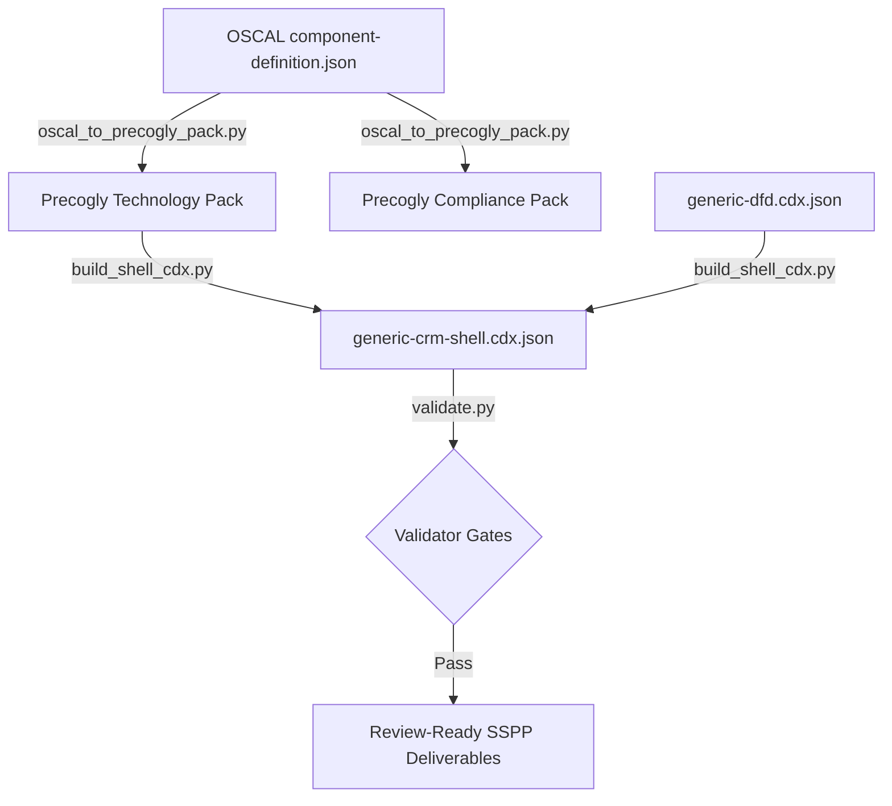

# Generic CRM System Threat Modeling Template

[← Repository README](../../README.md) · [Documentation index](../../docs/index.md) ·
[Threat model authoring guide](../../docs/threat-model-authoring-guide.md) ·
[Private system repository template](../private-system-repository/README.md)

This directory contains a **generic, reusable, and automated template** for turning NIST 800-53 OSCAL Component Definitions (like those maintained in `gsa-pages`) into Precogly-native assets.

Rather than hard-coding single-system pipelines, this directory establishes a complete working blueprint to model **any Customer Responsibility (CRM)** framework as a Precogly library pack and generate a corresponding visual diagram.

---

## Architecture and Design

When modeling Customer Responsibility Matrices (CRMs) as threat models, we separate the source data (OSCAL) from the rendering engine dialect. This workspace implements two standard formats:

1. **Precogly Library Pack Format (`pack_type: full`)**: Emits component, threat, countermeasure, and join files inside `pack/` which can be zipped and installed as a reusable library in Precogly. This allows a user to drop a "Cloud.gov" or "GSA Pages" component onto any DFD canvas and instantly inherit all associated threat boundaries.
2. **Precogly Compliance Pack (`pack_type: compliance`)**: Emits framework requirement definitions in `pack-oscal-800-53r5/` populated directly from the parsed OSCAL files and enriched with the NIST catalog titles/descriptions.
3. **CycloneDX Editor Shell (`generic-crm-shell.cdx.json`)**: Merges the generated packs and layers them onto a minimal baseline diagram (`data/model/generic-dfd.cdx.json`), exporting a single, bidirectionally linked file that can be opened directly in the Precogly guest editor.



---

## Directory Layout

```
templates/generic-crm-system/
  Makefile                       # Simple build orchestration
  README.md                      # This guide
  data/
    model/
      generic-dfd.cdx.json       # Minimal DFD baseline diagram
  scripts/
    oscal_to_precogly_pack.py    # OSCAL JSON -> Precogly full & compliance packs
    build_shell_cdx.py           # Packs + generic-dfd -> generic-crm-shell.cdx.json
    validate.py                  # Enums, linkage, and privacy redaction validator
  pack/                          # Generated Technology Pack (importable into Precogly)
  pack-oscal-800-53r5/           # Generated NIST 800-53 r5 Compliance Pack
  build/
    generic-crm-shell.cdx.json   # Generated CycloneDX visual threat model
```

---

## How to Run

Requirements: `uv` (PyYAML is pulled in automatically; set `UV=...` to use a
different runner).

The `Makefile` requires two inputs, and `make` stops with an error if either is
missing:

- `CATALOG` — path to a NIST 800-53 r5 OSCAL `catalog.json`.
- `OSCAL_SOURCES` — space-separated paths to one or more OSCAL
  `component-definition.json` files, one per CRM source.

From this directory (`templates/generic-crm-system/`):

```bash
# Run the entire pipeline (oscal convert -> shell build -> validate)
make all CATALOG=/path/to/catalog.json \
  OSCAL_SOURCES='/path/to/a/component-definition.json /path/to/b/component-definition.json'

# Step-by-step
make pack CATALOG=... OSCAL_SOURCES=...   # Parses the OSCAL files and populates pack/
make shell-cdx   # Generates the integrated visual CycloneDX shell
make validate    # Asserts enums, linkages, and runs the privacy filter
```

### Cold-start check

`make cold-start` copies this template to a temporary directory, clears the
generated packs, runs `make all` against the synthetic fixtures in
`examples/synthetic/` (a three-control catalog subset and a one-component
definition), and checks that both packs and the shell CycloneDX file were
written. It never modifies this directory. CI runs it on every pull request;
it finishes in a few seconds, so the "under one hour bootstrap" goal is
measured rather than assumed.

---

## Mapping Logic & ID Normalization

### 1. Control-ID Normalization

OSCAL definitions emit dotted lowercase identifiers like `ac-2`, `ac-6.5`, `ac-2.13`, whereas the NIST standard uses uppercase and parentheses. The pipeline normalizes these variations:

- `ac-2` $\rightarrow$ `AC-2`
- `ac-6.5` $\rightarrow$ `AC-6(5)`
- `ac-2.13` $\rightarrow$ `AC-2(13)`

### 2. Entity Translations

- **Components**: Each input OSCAL file maps to one Technology Component (e.g. `cloud_gov`, `gsa_pages`, `gsa_common_controls`) defined in `components.yaml`.
- **Threats**: Every implemented-requirement block is converted to a high-level Threat: `"CRM: <control_id> Responsibility Gap - <component_title>"`. The multi-line responsibility description is parsed, formatted, and set as the threat description.
- **Countermeasures**: An automated procedural countermeasure is generated for each threat to guide the user in meeting the obligation: `"Fulfill CRM responsibility for <control_id> on <component_title>"`.
- **Joins**:
  - `components-threats.yaml` maps all threats for source $X$ directly to component $X$ (`applies_to: component`).
  - `threats-countermeasures.yaml` links each threat to its corresponding procedural control.
  - `countermeasures-nist-800-53-r5.yaml` overlays each control to its matching NIST 800-53 r5 section_code so it resolves in the compliance audit tab.

---

## Redaction and Security Gates

A security threat model is itself a Reconnaissance target. Concrete email addresses, points-of-contact, internal data platform hosts, or non-localhost URLs let an attacker map endpoints and target spearphishing.

The script applies strict regex redactors on all parsed strings, and `validate.py` will halt the build (exiting non-zero) if any bare URL or email address bypasses the filter, guaranteeing complete privacy and compliance.
